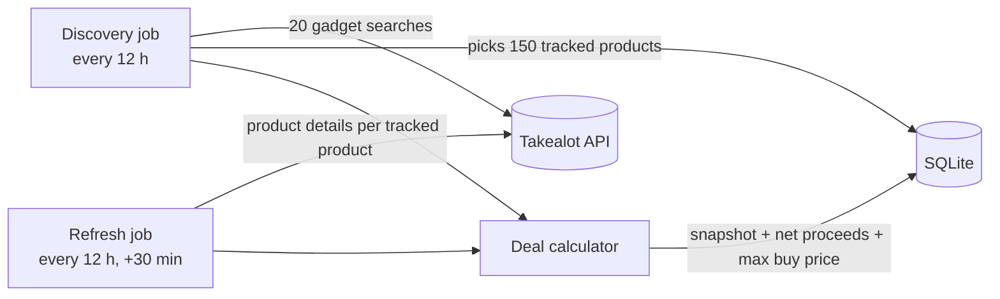

# FlipZA

FlipZA is a deal-intelligence engine for South African online resellers. It watches fast-moving, light tech gadgets on **Takealot**, records their prices, stock and competition over time, and works out **what each product is worth to a reseller** after Takealot's fees and VAT, including the **most a reseller can pay a supplier** and still make a worthwhile profit.

The goal is a B2B tool: resellers compare those numbers against supplier and clearance prices to find stock worth buying.

---

## What works today

| Area | Status |
|---|---|
| Takealot scraper (search + product details via Takealot's public JSON API) | Working |
| Discovery of fast-moving light gadgets (20 searches, filtered and ranked) | Working |
| Price, stock and competition history (SQLite) | Working |
| Deal calculator (fees, VAT, landed cost, ROI, max buy price) | Working |
| robots.txt enforcement, throttling, retries | Working |
| Docker deployment to a Linux VPS | Working |
| Supplier / clearance price sources | Planned |
| Telegram deal alerts | Planned |
| REST API (`FlipZA.Api`) | Placeholder (template only) |
| Makro marketplace, Playwright fallback, cross-border landed costs | Planned |

## How it works in one minute



1. **Discovery** searches Takealot for light gadgets (power banks, chargers, earbuds, smart watches, ...), keeps in-stock products priced R200–R3,000 with at least 20 reviews, and picks the 150 most-reviewed as the **tracked set**. Review count is the best public signal of how fast a product sells.
2. **Refresh** re-reads every tracked product twice a day and stores a **snapshot**: price, stock, buy-box seller, competing offers, reviews.
3. Every snapshot is run through the **deal calculator**, which stores what a reseller would keep from a sale and the **maximum supplier price** that still clears the deal gate (R80 profit and 25% ROI).

## Documentation

| Document | Read it to learn |
|---|---|
| [Architecture](docs/architecture.md) | How the projects fit together and how data flows |
| [Takealot scraper](docs/scraper.md) | Discovery and refresh jobs, what data is captured, politeness rules |
| [Deal calculator](docs/deal-calculator.md) | The profit, VAT, ROI and max-buy-price maths, with worked examples |
| [Data model](docs/data-model.md) | Database tables, columns and useful queries |
| [Configuration](docs/configuration.md) | Every setting, its default and what it changes |
| [Deployment](docs/deployment.md) | Running on the VPS with Docker, backups, viewing data |
| [Development](docs/development.md) | Building, testing, migrations, adding a marketplace |

## Quick start (local)

Requires the [.NET 9 SDK](https://dotnet.microsoft.com/download/dotnet/9.0).

```bash
git clone https://github.com/simseza022/FlipZA.git
cd FlipZA
dotnet tool restore          # installs the pinned dotnet-ef tool
dotnet test                  # run the test suite
dotnet run --project src/FlipZA.Engine
```

The Engine creates `src/FlipZA.Engine/flipza.db` on first run, applies database migrations, runs discovery immediately and the first refresh 30 minutes later. See [Deployment](docs/deployment.md) to run it on a server.

## Repository layout

```text
FlipZA/
├── src/
│   ├── FlipZA.Core/            Domain entities, interfaces and the deal calculator (no framework dependencies)
│   ├── FlipZA.Infrastructure/  Takealot client and parser, HTTP politeness, EF Core + SQLite persistence
│   ├── FlipZA.Engine/          Worker service: Quartz jobs, configuration, Dockerfile
│   └── FlipZA.Api/             REST API (placeholder)
├── tests/FlipZA.Tests/         xUnit tests with real Takealot response fixtures
├── docs/                       This documentation
├── docker-compose.yml          Production deployment of the Engine
└── .config/dotnet-tools.json   Pinned dotnet-ef version
```

## Tech stack

.NET 9 · C# · Quartz.NET · EF Core 9 + SQLite · Microsoft.Extensions.Http.Resilience · xUnit · Docker Compose on Ubuntu 24.04

## Responsible scraping

FlipZA identifies itself with an honest User-Agent, obeys Takealot's `robots.txt`, spaces requests at least 2.5 seconds apart and makes roughly 400 requests a day. Takealot's Terms of Use have **not yet been reviewed**; do that before relying on this commercially.
