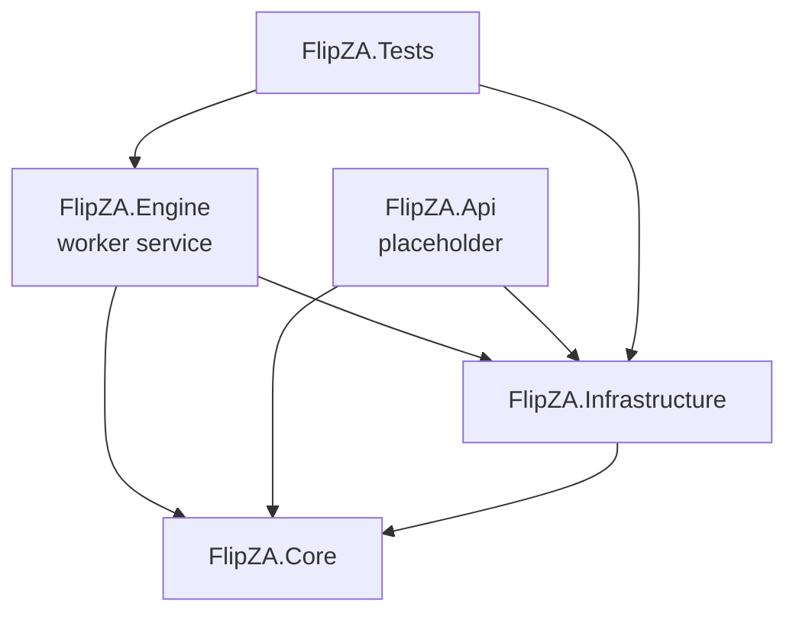
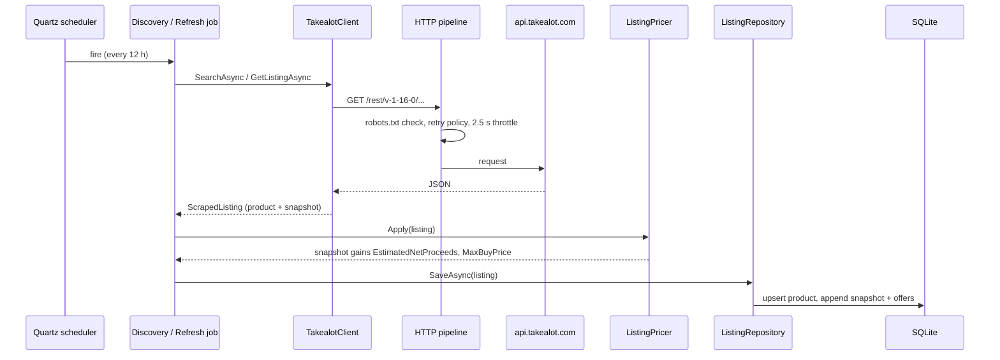

# Architecture

FlipZA follows **Clean Architecture**: business rules live in a core project with no external dependencies, and everything that talks to the outside world (HTTP, database, scheduler) sits in outer projects that depend inward.

## Projects and dependencies

| Project | Responsibility | Depends on |
|---|---|---|
| **FlipZA.Core** | Domain entities (`MarketplaceProduct`, `ListingSnapshot`, `CompetingOffer`), search types, the interfaces `IMarketplaceSource` and `IListingRepository`, and the deal calculator. Pure C#, no NuGet packages. | nothing |
| **FlipZA.Infrastructure** | `TakealotClient` and `TakealotParser`, the HTTP pipeline (robots.txt, retries, throttling), `FlipZaDbContext`, migrations and `ListingRepository`. | Core |
| **FlipZA.Engine** | The executable. Hosts Quartz.NET, runs the discovery and refresh jobs, binds configuration, stamps deal economics onto snapshots (`ListingPricer`), applies migrations at startup. | Core, Infrastructure |
| **FlipZA.Api** | Future REST API for dashboards and webhooks. Currently the ASP.NET template. | Core, Infrastructure |
| **FlipZA.Tests** | Unit and integration tests. Uses saved Takealot responses, so tests never hit the network. | Engine, Infrastructure |

**Why this split:** the deal maths and domain types can be tested and reused (by the Engine today, the API later) without dragging in HTTP clients or a database. Adding Makro means adding a new `IMarketplaceSource` implementation in Infrastructure; nothing in Core changes.

## Key types

| Type | Project | Role |
|---|---|---|
| `MarketplaceProduct` | Core | Slow-changing catalogue data: title, brand, barcode, category, attributes, `IsTracked`. One row per product. |
| `ListingSnapshot` | Core | Point-in-time price, stock, buy box, competition and deal economics. Many per product. |
| `CompetingOffer` | Core | Other sellers' offers captured with a snapshot. |
| `MarketplaceSearch` / `MarketplaceSearchHit` | Core | A search request, and the cheap per-product summary that search results return. |
| `IMarketplaceSource` | Core | "Search a marketplace" and "get full details for one product". Implemented by `TakealotClient`. |
| `IListingRepository` | Core | Save snapshots, manage the tracked set. Implemented by `ListingRepository`. |
| `DealCalculator`, `FeeSchedule`, `ResellerProfile`, `DealGate` | Core | The deal maths and its inputs. See [Deal calculator](deal-calculator.md). |
| `TakealotClient` | Infrastructure | Calls Takealot's REST API through the polite HTTP pipeline. |
| `TakealotParser` | Infrastructure | Turns Takealot JSON into Core entities, tolerating missing fields. |
| `TakealotDiscoveryJob`, `TakealotRefreshJob` | Engine | The two scheduled jobs. See [Takealot scraper](scraper.md). |
| `ListingPricer` | Engine | Runs the deal calculator on each snapshot with the configured settings. |

## Runtime flow

## Startup sequence (`src/FlipZA.Engine/Program.cs`)

1. Load configuration (`appsettings.json`, then environment variables).
2. Register Infrastructure (`AddInfrastructure`): database, repository, HTTP clients and handlers.
3. Register `TakealotScraperSettings`, `DealSettings` and `ListingPricer`.
4. Register the Quartz jobs and triggers:
   - discovery: starts immediately, repeats every `Discovery.IntervalHours`;
   - refresh: starts after `Refresh.InitialDelayMinutes`, repeats every `Refresh.IntervalHours`.
5. Build the host, **apply pending EF Core migrations**, and switch SQLite to **WAL mode**.
6. Run until stopped. On shutdown Quartz waits for a running job to finish.

## Design principles

- **Snapshots, not overwrites.** Prices are appended as history, never updated in place. Trends (and review-count growth as a sales signal) need history.
- **Tolerant parsing.** A renamed or missing field in Takealot's JSON yields an empty value, not a crash. The raw payload is kept so data can be re-parsed later.
- **Money as `decimal` in code.** All maths uses `decimal`. SQLite stores it as `REAL` because SQLite's `decimal` (text) breaks comparisons and sorting in queries.
- **Times in UTC.** Every timestamp is stored as UTC.
- **Polite by construction.** robots.txt, throttling and retries live in the HTTP pipeline, so no job can bypass them.
