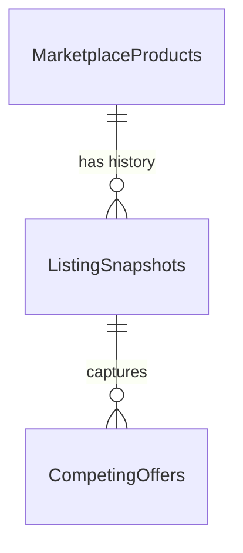

# Data model

FlipZA stores everything in a single SQLite file (`flipza.db`; on the VPS, `/opt/flipza/data/flipza.db`). The schema is managed by EF Core migrations in `src/FlipZA.Infrastructure/Persistence/Migrations/` and applied automatically when the Engine starts.



- **One product row** per Takealot product, updated in place on every scrape.
- **One snapshot row** per scrape, never updated: this is the price history.
- **Competing offer rows** belong to a snapshot: the other sellers at that moment.

## Storage conventions

| Kind | Stored as | Notes |
|---|---|---|
| Money and ratings | `REAL` | `decimal` in code; `REAL` keeps comparisons and `ORDER BY` correct in SQLite |
| Booleans | `INTEGER` | `0` = false, `1` = true |
| Timestamps | `TEXT` | Always **UTC**, e.g. `2026-10-19 20:00:53.0396176` |
| `Marketplace` | `TEXT` | `Takealot` |
| `Attributes` | `TEXT` | JSON object, e.g. `{"brand":"Volkano","power":"10.0 W"}` |

The database runs in **WAL mode**, so it can be read while the Engine writes. See [Deployment](deployment.md#viewing-the-data) for how to read it safely.

---

## `MarketplaceProducts`

| Column | Type | Description |
|---|---|---|
| `Id` | int | Internal key |
| `Marketplace` | text | `Takealot` |
| `ExternalId` | text | Takealot PLID, e.g. `PLID98945485` |
| `VariantId` | text | Takealot TSIN (variant id) |
| `Title`, `Subtitle`, `Brand` | text | |
| `Barcode` | text | EAN/UPC: the key for matching supplier stock |
| `ModelNumber` | text | |
| `Department` | text | e.g. `Cellphones & Wearables` |
| `CategoryPath` | text | e.g. `Home & Kitchen > Small Kitchen Appliances > Cooking Appliances > Air Fryers` |
| `LeafCategoryId` | int | Most specific category id (used for success-fee overrides) |
| `Url`, `ImageUrl` | text | |
| `Dimensions`, `Weight`, `Warranty` | text | As displayed by Takealot; often empty |
| `Attributes` | text (JSON) | All product attributes |
| `IsTracked` | bool | `1` = refreshed twice daily. Set by the discovery job. |
| `FirstSeenAtUtc` | text | First scrape |
| `LastSeenAtUtc` | text | Latest scrape |
| `LastRawPayload` | text | Latest full Takealot response (~20–50 KB) |

Indexes: unique `(Marketplace, ExternalId)`; `Barcode`; `(Marketplace, IsTracked, LastSeenAtUtc)`.

## `ListingSnapshots`

| Column | Type | Description |
|---|---|---|
| `Id` | int | |
| `ProductId` | int | → `MarketplaceProducts.Id` |
| `CapturedAtUtc` | text | When the scrape happened |
| `Price` | real | Buy-box price (empty if not purchasable) |
| `ListPrice` | real | "Was" price |
| `IsInStock` | bool | |
| `IsLeadTime` | bool | Ships from the seller, not a Takealot warehouse |
| `StockStatus` | text | e.g. `In stock` |
| `DistributionCentres` | text | e.g. `CPT,DBN,JHB` |
| `IsMarketplaceSeller` | bool | `1` = third-party seller holds the buy box; `0` = Takealot |
| `BuyBoxSellerId`, `BuyBoxSellerName` | text | `Takealot` when Takealot sells it |
| `BuyBoxSellerVatRegistered` | bool | |
| `BuyBoxSellerRating` | real | Seller score (third-party sellers only) |
| `StarRating` | real | Product rating |
| `ReviewCount` | int | Growth between snapshots is a sales signal |
| `OtherOffersCount` | int | Number of competing offers |
| `LowestOtherOfferPrice` | real | Cheapest competing offer |
| `PromotionName` | text | e.g. `Pay Day Deals` |
| `EstimatedNetProceeds` | real | What a reseller keeps per sale; see [Deal calculator](deal-calculator.md) |
| `MaxBuyPrice` | real | Highest supplier price that passes the deal gate |

Index: `(ProductId, CapturedAtUtc)`.

## `CompetingOffers`

| Column | Type | Description |
|---|---|---|
| `Id` | int | |
| `SnapshotId` | int | → `ListingSnapshots.Id` |
| `Condition` | text | e.g. `New` |
| `SellerId`, `SellerName` | text | |
| `IsMarketplaceOperator` | bool | `1` if the offer is Takealot's own |
| `SellerVatRegistered` | bool | |
| `Price` | real | |
| `IsInStock` | bool | |
| `StockStatus` | text | e.g. `Ships in 3 - 5 work days` |

## Growth

At 150 tracked products checked twice a day, the database grows by about 300 snapshots a day plus their competing offers, roughly **10–30 MB per month**. `LastRawPayload` is overwritten rather than accumulated.

---

## Useful queries

### Latest state of every tracked product, best opportunities first

```sql
SELECT p.ExternalId,
       substr(p.Title, 1, 45) AS Title,
       p.Department,
       s.Price,
       s.EstimatedNetProceeds,
       s.MaxBuyPrice,
       s.ReviewCount,
       s.OtherOffersCount,
       s.BuyBoxSellerName
FROM MarketplaceProducts p
JOIN ListingSnapshots s
  ON s.Id = (SELECT Id FROM ListingSnapshots
             WHERE ProductId = p.Id
             ORDER BY CapturedAtUtc DESC LIMIT 1)
WHERE p.IsTracked = 1
  AND s.MaxBuyPrice IS NOT NULL
ORDER BY s.ReviewCount DESC;
```

### Price history of one product

```sql
SELECT s.CapturedAtUtc, s.Price, s.MaxBuyPrice, s.IsInStock, s.BuyBoxSellerName, s.ReviewCount
FROM ListingSnapshots s
JOIN MarketplaceProducts p ON p.Id = s.ProductId
WHERE p.ExternalId = 'PLID98945485'
ORDER BY s.CapturedAtUtc;
```

### Fastest-selling products (review growth over the last 7 days)

```sql
SELECT p.ExternalId,
       substr(p.Title, 1, 45) AS Title,
       MAX(s.ReviewCount) - MIN(s.ReviewCount) AS NewReviews,
       MAX(s.ReviewCount) AS TotalReviews
FROM ListingSnapshots s
JOIN MarketplaceProducts p ON p.Id = s.ProductId
WHERE s.CapturedAtUtc >= datetime('now', '-7 days')
GROUP BY p.Id
ORDER BY NewReviews DESC
LIMIT 25;
```

### Competing sellers on a product's latest snapshot

```sql
SELECT o.SellerName, o.Price, o.Condition, o.SellerVatRegistered, o.StockStatus
FROM CompetingOffers o
WHERE o.SnapshotId = (SELECT s.Id FROM ListingSnapshots s
                      JOIN MarketplaceProducts p ON p.Id = s.ProductId
                      WHERE p.ExternalId = 'PLID98945485'
                      ORDER BY s.CapturedAtUtc DESC LIMIT 1)
ORDER BY o.Price;
```

### Health check

```sql
SELECT (SELECT COUNT(*) FROM MarketplaceProducts WHERE IsTracked = 1) AS tracked,
       (SELECT COUNT(*) FROM ListingSnapshots)                        AS snapshots,
       (SELECT MAX(CapturedAtUtc) FROM ListingSnapshots)              AS last_scrape_utc;
```
